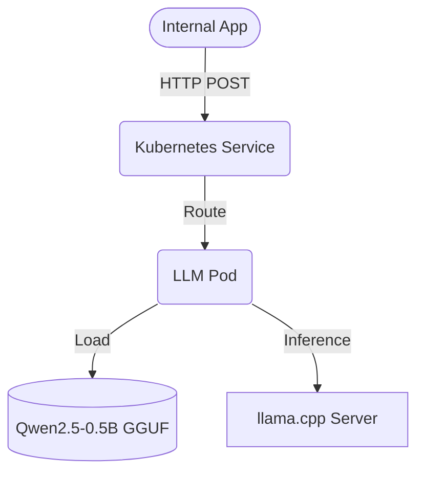

# On-Premise LLM Deployment (Kubernetes + llama.cpp)

Deployment of a quantized Large Language Model (Qwen2.5-0.5B-Instruct) inside a Kubernetes cluster using `llama.cpp`. Designed for air-gapped (offline) environments where external API calls (like OpenAI or Gemini) are strictly prohibited.

## Business Context
Many enterprise clients (banks, government, healthcare) handle sensitive data and cannot send it to external cloud providers. This project demonstrates how to deploy a lightweight, quantized LLM (GGUF format) entirely on-premise using CPU-only infrastructure. It provides a private, secure, and fast inference API via standard HTTP.

## Architecture



## Key Features
- **Offline Execution:** The Docker image is pre-built with the model weights inside, meaning no internet connection is required during pod startup.
- **Quantization (GGUF):** Uses a 4-bit quantized model (Q4_K_M) to drastically reduce memory footprint, allowing it to run on CPU-only nodes.
- **Kubernetes Native:** Deployed via standard Kubernetes `Deployment` and `Service` manifests, easily scalable and manageable.
- **Resource Constraints:** Strict CPU and Memory limits are defined to ensure stable cluster operation.

## Tech Stack
`Kubernetes (Minikube)` · `Docker` · `llama.cpp` · `Qwen2.5-0.5B` · `GGUF`

## Deployment Guide

1. **Build the Docker image (includes the model):**
   ```bash
   docker build -t llama-llm:local .
   ```
   
2. **Load the image into your local Minikube cluster:**
   ```bash
   minikube image load llama-llm:local
   ```
   
3. **Apply the Kubernetes manifests:**
   ```bash
   kubectl apply -f deployment.yaml
   ```
   
4. **Port-forward the service for testing:**
   ```bash
   kubectl port-forward svc/llama-llm 8081:8080
   ```
   
5. **Send a test request:**
   ```bash
   curl -X POST http://localhost:8081/v1/completions \
     -H "Content-Type: application/json" \
     -d '{"prompt": "What is the capital of France?", "max_tokens": 50}'
   ```